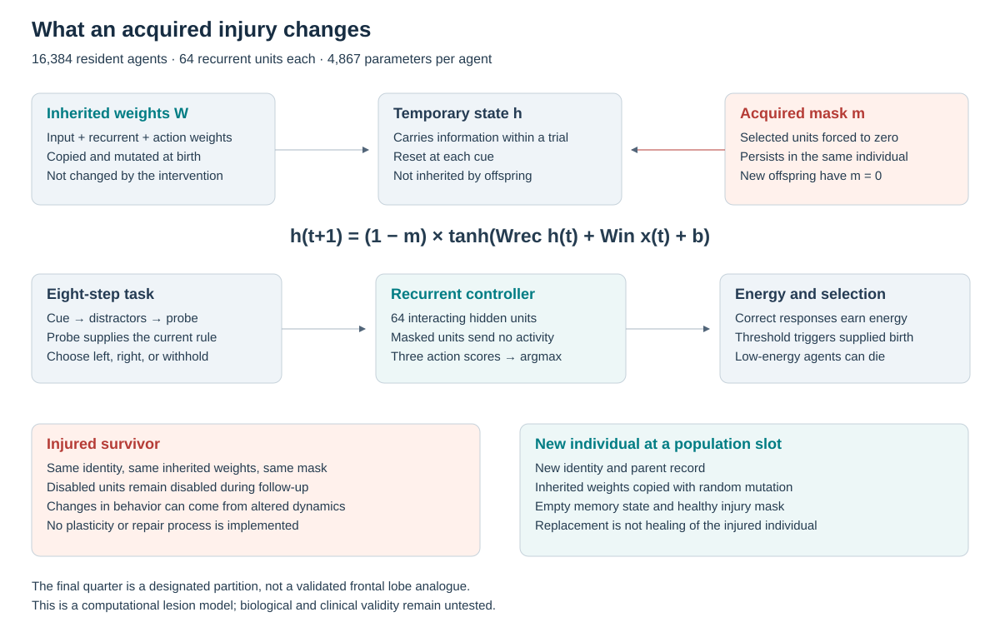
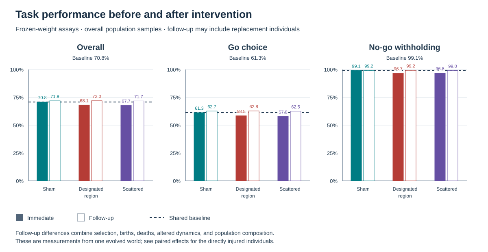
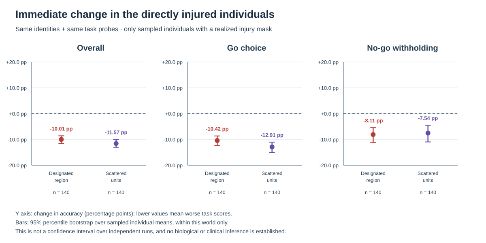
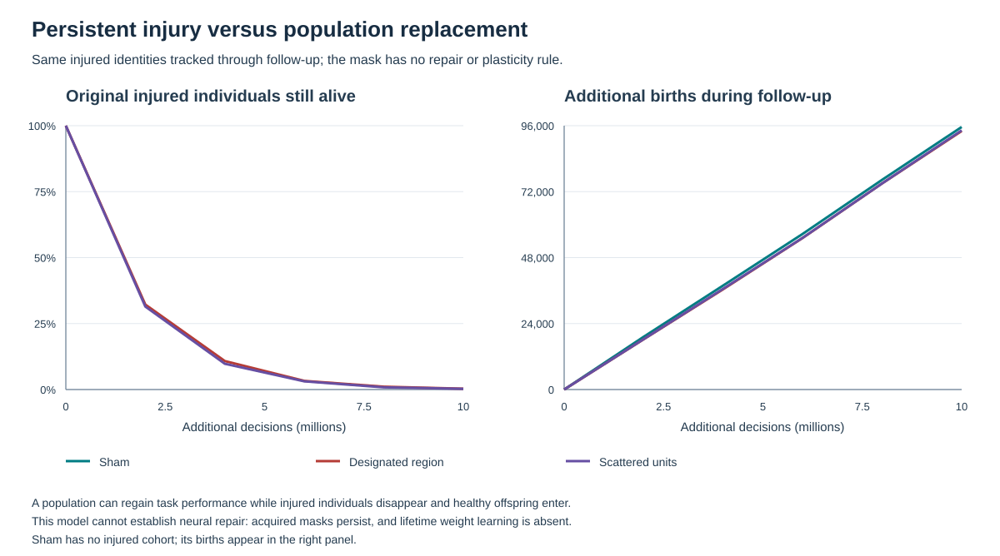
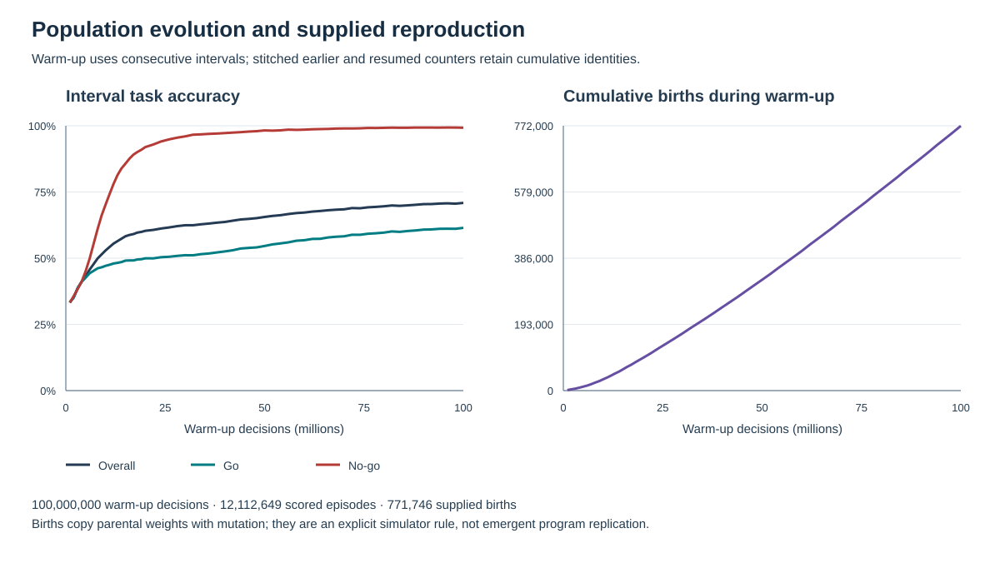
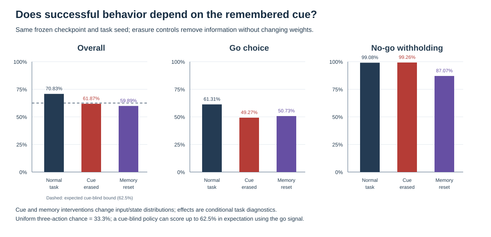
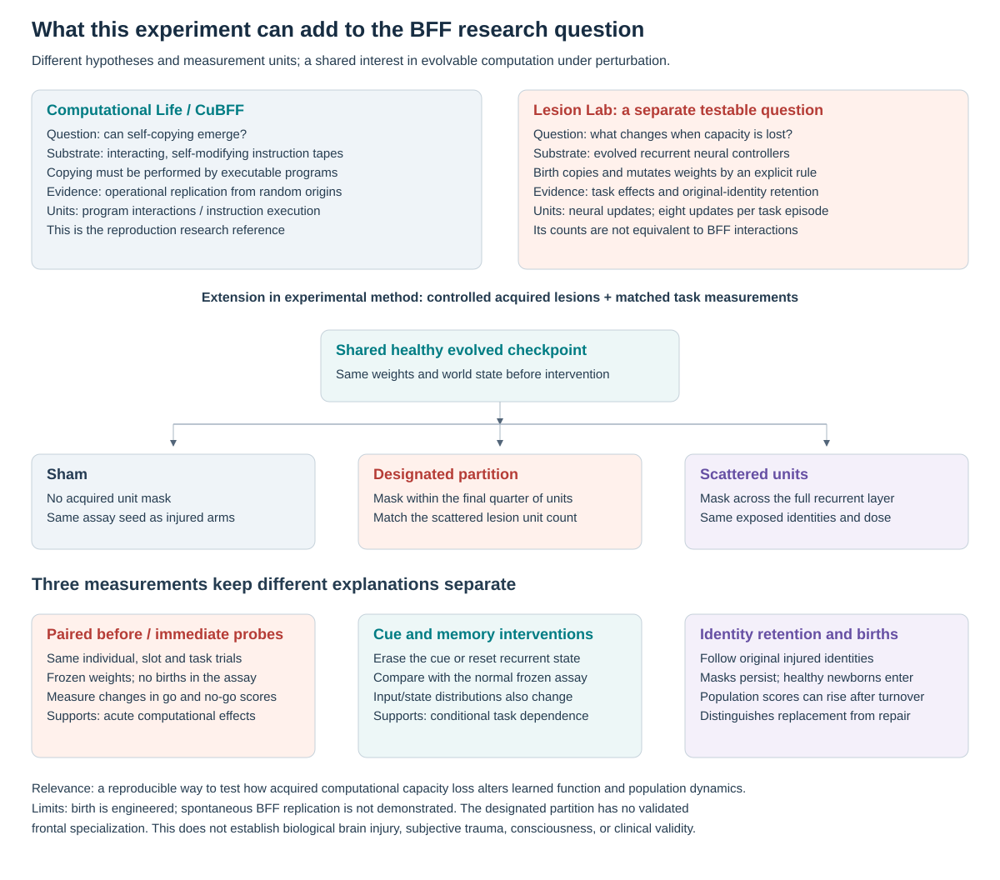
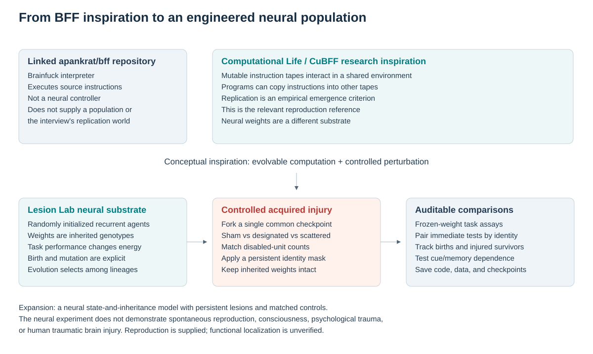

# Lesion Lab

**Digital evolution, persistent computational injury, and honest tests of what changes afterward.**

Lesion Lab evolves 16,384 independent recurrent neural agents from random weights, then forks the same healthy population into sham, designated-region injury, and scattered-unit injury conditions. The published experiment uses 100 million scheduled steps before injury and 10 million additional steps per branch, with a required minimum of 10 million complete scored task trials before injury.

[Results and interpretation](RESULTS.md) · [Download the evolved populations](https://github.com/jkubiniec/lesion-lab/releases/tag/v0.1.0) · [Model card](MODEL_CARD.md) · [Protocol](PROTOCOL.md) · [Source review](RESEARCH.md) · [Original BFF comparison](BFF_COMPARISON.md)

<!-- MEASURED_RESULTS_START -->
The completed healthy checkpoint contains **99,966,597 actual neural updates**, **12,112,649 complete scored task episodes**, and **771,746 births**. Its held-out accuracy is **70.83%**. Immediate injury lowers it to **68.09%** (designated region) and **67.67%** (scattered units). Cue erasure lowers healthy accuracy to **61.87%**, supporting cue dependence on this task. Follow-up population scores return to about 72%, while only 13 and 11 of the original 4,096 injured agents remain; that is population turnover, not demonstrated individual repair. All 62 validation checks pass. See [RESULTS.md](RESULTS.md) for task-specific scores, paired effects, uncertainty and limits.
<!-- MEASURED_RESULTS_END -->

## What is evolving?



Each agent has eight inputs, 64 recurrent hidden units, three actions (withhold, left, right), energy, a stable identity and ancestry. Its **4,867 inherited weights** mutate at birth. The population holds **79,740,928 weights** in total; these belong to separate small controllers. There are no pretrained models, model APIs, gradient updates or lifetime weight learning.

Agents receive a cue, six delay phases with distractors, and a probe. The probe explicitly supplies a normal/reversed response rule and a go/no-go instruction. Correct responses increase energy; enough energy triggers simulator-supplied reproduction and slot replacement. This is an evolutionary training procedure with designed rewards and birth rules. It is not the spontaneous invention of copying.

A scheduled step visits one resident slot; a dead slot is skipped. An actual neural evaluation updates a living controller once. A scored episode is a complete-cue probe after an eight-phase task. These are **agent–environment interactions**, distinct from BFF program-pair interactions. Agents compete through reproduction and replacement; they do not communicate.

## What does the injury do?

The intervention selects 25% of the living population and disables eight of each affected agent's 64 recurrent units for its lifetime (12.5% of the controller). Those activations are forced to zero, removing their recurrent and output contributions while leaving the inherited weights intact.

- **Sham:** reload the identical population without adding masks.
- **Designated region:** disable eight units within the final quarter of the controller.
- **Scattered units:** disable eight units sampled across all 64 hidden units, in the same original individuals.

Severity 0.5 means half of the 16-unit designated region, not half of the whole controller. The final-quarter partition is a design choice. The code's internal name `executive` does not establish an executive module or frontal-lobe anatomy. This intervention models a persistent loss of computational capacity. Tissue impact, inflammation, psychological trauma and subjective experience are not simulated.





Immediate frozen assays compare the same controller IDs, slots and held-out task sequences. Charts distinguish the effect on the whole sampled population from the paired effect within affected individuals. Intervals resample agents within this single evolved world; they do not establish reproducibility across independent evolutionary seeds.

## Is later improvement repair?



An acquired mask persists for the injured individual's life. Children get new IDs and healthy masks. Healthy descendants can therefore replace injured residents. There is **no individual repair or lifetime relearning** in this version. Follow-up scores describe a changing population and must be read alongside original-cohort retention.



## Did the agents learn cue memory?



The supplied go/no-go signal makes the expected cue-blind ceiling **62.5% overall**: withhold correctly on 25% of trials and guess direction on the 75% go trials. Uniform random action is 33.3%; a static left/right action scores 37.5%. Exceeding those weaker baselines alone does not establish memory.

The release includes ordinary trials, trials with the initial cue erased, and trials with recurrent state reset immediately before the probe. We report go and no-go performance separately and compare the same task targets. The measured effects and limits are in [RESULTS.md](RESULTS.md).

## How this extends BFF

[Read the detailed whitepaper comparison](BFF_COMPARISON.md), including mechanisms, scale, falsifiable hypotheses, and the experiments needed to bridge the two models.





The [Big Think interview](https://bigthink.com/series/full-interview/agi-life-consciousness/) motivates the question: what persists through reproduction, and what happens when the underlying computation is impaired? The supplied [apankrat/bff](https://github.com/apankrat/bff) is an ordinary optimizing Brainfuck interpreter. The computational-life work uses a different shared-code/data substrate, described in [Computational Life](https://arxiv.org/html/2406.19108v1) and [CuBFF](https://github.com/paradigms-of-intelligence/cubff).

| Feature | Research BFF / CuBFF | This recurrent population |
| --- | --- | --- |
| Individual | Short self-modifying byte program | Small recurrent neural controller |
| Reproduction | Programs overwrite other programs; copying can emerge | Explicit energy threshold copies and mutates weights |
| Selection | Persistence under repeated program interactions | Designed task rewards, metabolic costs and replacement |
| Heritable material | Program bytes | Float32 neural weights |
| Acquired impairment | Added here as an execution mask in the separate bytecode experiment | Persistent zero-activation mask attached to an individual's ID |
| Primary measurement | Functional copying into independent food | Held-out action accuracy, paired lesion effects, ancestry and cohort survival |

The expansion adds richer temporary state, behavioral tasks, acquired neural masks, matched intervention branches, identity tracking and downloadable evolved weights. **The neural agents did not emerge from the BFF soup.** The repository also retains an independent CPU BFF-inspired experiment (`engine.cpp`, `lab.py`) and a separate small supervised controller (`executive.py`) as earlier experimental tools. They do not supply the current neural model's learned weights. [RESEARCH.md](RESEARCH.md) records reviewed commits and deliberate departures from research BFF.

## Reproduce the experiment

Requirements: Python 3.10+ standard library and a C++17 compiler (`clang++` or `g++`). macOS/Linux are supported by the resource-control code. Node.js is needed only for the legacy report JavaScript tests. No GPU or Python package installation is required.

```sh
git clone https://github.com/jkubiniec/lesion-lab.git
cd lesion-lab
python3 lab.py build
python3 -m unittest discover -s tests -v
python3 -u reproduce.py --out runs/reproduced-seed42
```

`reproduce.py` reads [experiment.json](experiment.json), displays real terminal progress, runs the three injury branches and cue controls, and regenerates tables and diagrams. It refuses an existing run folder. A failed minimum-episode check saves the healthy checkpoint and stops before injury; it never silently relabels scheduled steps as completed tasks.

For a brief smoke run, using the smaller safe defaults:

```sh
python3 -u neural_terminal.py --out runs/smoke
```

To mirror the recorded healthy-prefix continuation:

```sh
python3 -u neural_terminal.py --population 16384 --hidden 64 --seed 42 \
  --decisions 20000000 --followup 0 --no-lesions \
  --max-memory-mib 512 --max-checkpoint-gib 3 --minimum-free-gib 5 \
  --cpu-seconds 1200 --max-run-seconds 1800 --out runs/prefix20m
python3 -u neural_terminal.py --resume runs/prefix20m/warmup.bin \
  --decisions 80000000 --followup 10000000 --minimum-episodes 10000000 \
  --assay-samples 512 --assay-trials 64 --progress-every 2000000 \
  --max-memory-mib 512 --max-checkpoint-gib 3 --minimum-free-gib 5 \
  --cpu-seconds 1200 --max-run-seconds 1800 --out runs/continued100m
```

Checkpoint continuation is tested for exact equality within the native implementation. Different compilers, architectures or math libraries can change floating-point results and long evolutionary trajectories; source, configuration and checksums are retained to make that limitation explicit.

## Resource limits

The published run uses **one CPU thread**, a **512 MiB model-allocation estimate budget**, a **3 GiB saved-data forecast**, at least **5 GiB remaining free disk**, a **1,200-second CPU limit per native process**, and a **30-minute experiment deadline**. The estimate is not a guaranteed cap on total process memory. The sandbox prevented lowering process priority; the manifest records the actual nice increment as zero. No machine-wide settings are changed.

Ctrl-C stops the runner and simulator process group. Checkpoints are saved at completed stages, so interrupting an active stage can lose its unsaved work. Model packaging streams its input and separately checks the disk reserve. Downloading and decompressing every model needs additional disk space.

## Load the evolved model

The [v0.1.0 release](https://github.com/jkubiniec/lesion-lab/releases/tag/v0.1.0) contains **four full population checkpoints**: the healthy baseline and the sham, designated-region and scattered-unit final worlds. Download `SHA256SUMS`, `release_manifest.json`, and the population archive you want. Verify the archive before decompressing it, for example on macOS:

```sh
shasum -a 256 baseline-population-neural02.bin.gz
gzip -dk baseline-population-neural02.bin.gz
python3 model_io.py inspect --checkpoint baseline-population-neural02.bin
python3 model_io.py extract --checkpoint baseline-population-neural02.bin \
  --slot 0 --output agent.json
python3 model_io.py predict --model agent.json \
  --input '[1,0,0,0,0,0,0,0]' --reset
```

Compare the printed checksum with `SHA256SUMS`. The native population files contain all inherited weights, identities, ancestry, energy, recurrent state, masks and RNG state. Their NEURAL02 scalar layout is native little-endian. The source/results archive includes the exact run source and human-readable audit data.

The small [portable JSON examples](models/) export predetermined slot 0, chosen without fitness inspection. They are examples, not best agents or population averages; an example from an injury branch may be uninjured. Their actual mask is included. `model_io.py` supports recurrent inference with explicit state passed between inputs.

## Files and evidence

| Path | Purpose |
| --- | --- |
| `neural_engine.cpp` | Recurrent inference, ecology, injury, checkpoints and frozen assays |
| `neural_lab.py`, `neural_terminal.py` | Bounded orchestration and real progress output |
| `reproduce.py`, `experiment.json` | Published experiment recipe and cue controls |
| `analyze_large_run.py` | Audited tables, identity pairing and SVG diagrams |
| `model_io.py`, `package_release.py` | Portable inference, full model export, source/results bundles and checksums |
| `results/latest/` | Compact manifest, raw frozen assays, progress logs and analysis tables |
| `docs/figures/` | Regenerable architecture, experiment and measured-result diagrams |
| `MODEL_CARD.md`, `PROTOCOL.md`, `RESEARCH.md`, `BFF_COMPARISON.md` | Intended use, interpretation, whitepaper comparison and source provenance |
| `tests/` | Meaningful checks for continuation, causality, masks, inference, resource limits and packaging |

Earlier generated model/run folders were deleted at the owner's request before the larger experiment; the compact [cleanup record](docs/cleanup-record.json) records what was removed. Source code was retained. Only measured current-run results and explicitly labeled historical provenance should be treated as this release's evidence.

## Next experiments

An [independent-world replication runner](docs/replication-study.md) now repeats the matched injury branches and cue controls across declared evolution seeds, preserving original-cohort retention and estimating uncertainty across worlds. Start with its small software check:

```sh
python3 replication.py --preset smoke --seeds 101 202 303 \
  --out runs/replication-smoke --max-batch-seconds 120
```

This smoke run verifies the pipeline; it does not reproduce the published 100-million-step experiment or demonstrate individual repair. The runner refuses existing output directories and records actual neural updates and complete scored episodes separately from scheduled steps. See the [study protocol](docs/replication-study.md) for a substantive replication recipe and interpretation limits.

Replicate independent evolution and lesion seeds; establish cue-memory competence on held-out task families; map functional specialization before calling a region executive; compare matched connection loss; then test learning within the same injured IDs while masks remain fixed. Psychological trauma and biological TBI would require separately justified models and validation.

